<div align="center">

# 🚀 My SQL Learning Portfolio

### Building My Full Stack Development Journey, One Lesson at a Time.


<br><br>

<a href="https://github.com/mr-nexora">

</a>

<a href="https://www.linkedin.com/in/mrnexora/">

</a>

<a href="https://mr-nexora.github.io/mr-nexora-personal-portfolio/">

</a>

</div>

---

# 👋 Welcome

Welcome to my **MySQL Learning Repository**.

This repository documents my complete learning journey in MySQL as part of my Full Stack Development roadmap. Every lesson includes well-organized SQL queries, explanations, practice exercises, database designs, and real-world examples to strengthen my database management and query writing skills.

---

# 📂 Repository Overview

| 📌 Information | Details |
|:---------------|:--------|
| 👨‍💻 Author | **T.M.S.U. Thennakoon (Sahan Udara)** |
| 🎓 Program | Computer Science Undergraduate |
| 💻 Technology | mySQL |
| 📚 Learning Method | Daily Lessons & Hands-on Practice |
| 🎯 Goal | Become a Professional Full Stack Developer |
| 📅 Repository Started | 2026 |

---

# ✨ What's Inside

- 📖 Structured Lessons
- 💻 Source Code
- 📷 Output Screenshots
- 📝 Markdown Notes
- 🚀 Mini Projects
- 📚 Practice Exercises
- 📈 Continuous Progress Updates

---

# 🌍 Connect With Me

<div align="center">

<a href="https://github.com/mr-nexora">

</a>

<a href="https://www.linkedin.com/in/mrnexora/">

</a>

<a href="https://mr-nexora.github.io/mr-nexora-personal-portfolio/">

</a>

</div>

---

# 📚 Learning Resources

This repository is built through continuous practice using educational resources such as:

- W3Schools
- MDN Web Docs
- freeCodeCamp

---

# ⚖️ Copyright

> **© 2026 T.M.S.U. Thennakoon (Sahan Udara). All Rights Reserved.**
>
> This repository has been created for educational, portfolio, and personal learning purposes.
>
> You are welcome to explore the code and learn from it. However, copying, redistributing, or presenting this work as your own without permission is not allowed.

---
<div align="center">

⭐ If you find this repository useful, consider giving it a Star.

Happy Coding! 🚀

</div>

---

# Introduction-to-RDBMS

## MySQL Intro

### What is MySQL?

## MySQL is a popular open-source Relational Database Management System (RDBMS). It is fast, reliable, easy to use, and works on many operating systems like Windows, Linux, and macOS. It helps you store, organize, and manage large amounts of data efficiently.

## MySQL RDBMS

### What is RDBMS?

RDBMS stands for Relational Database Management System. It is a software system used to create, manage, and query relational databases. Data in an RDBMS is stored in structured tables that can connect (relate) to each other using keys.

### What is a Database Table?

A Database Table is a collection of related data stored in a structured grid made of Rows (Records) and Columns (Fields).

- Columns define the type of data (e.g. ProductName, Price).
- Rows hold the actual values for individual items.

### What is a Relational Database?

A Relational Database is a database that stores data in multiple tables that are linked together using Primary Keys and Foreign Keys. This helps avoid data duplication and maintains data consistency across the entire database.

---

## MySQL SQL

### What is SQL?

SQL stands for Structured Query Language. It is the standard programming language used to communicate with relational databases. Using SQL, you can create databases, insert new records, update existing records, delete data, and retrieve specific information using queries.

### How to Use SQL

`To use SQL:`

1. Connect to your database server (e.g., MySQL Server via Command Line, MariaDB terminal, or MySQL Workbench).
2. Type your SQL command ended with a semicolon ;.
3. Press Enter to execute the query and view the result in your terminal or output window.

---

## MySQL Comments

### MySQL Single-line Comments

Single-line comments are used to add short notes or explanations in your SQL script. Anything after -- (with a space) or # on the same line is ignored by MySQL during execution.

```mySQL
    -- This is a Single line Comment
```

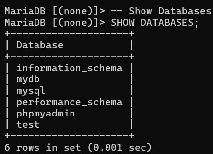

### MySQL Multi-line Comments

Multi-line comments are used to add longer explanations or temporarily disable multiple lines of code. They start with /_ and end with _/.

```mySQL
    /* This
    is
    a
    multi-line
    Comment */
```

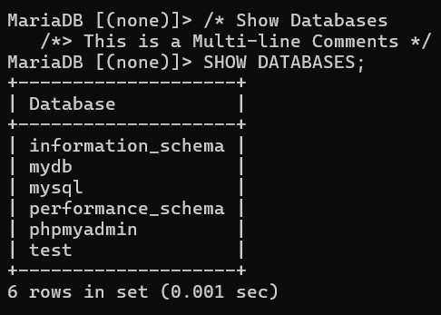

---

## MySQL Operators

An operator is a reserved word or character used in SQL statements to perform arithmetic calculations, comparisons, logical operations, and bit manipulation.

### Arithmetic operators

- Arithmetic operators are used to perform mathematical operations such as addition, subtraction, multiplication, and division on numeric values.

`1. Addition(+)`
Adds two numbers together.

```mySQL
    SELECT 30 + 20;
```

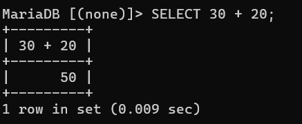

`2. Subtraction(-)`

- Subtracts the right number from the left number.

```mySQL
    SELECT 100 - 35;
```

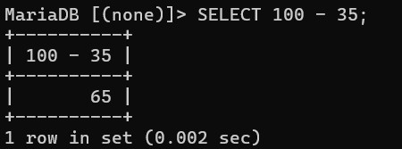

`3. Multiplication(\*)`

- Multiplies two numbers.

```mySQL
    SELECT 25 * 5;
```

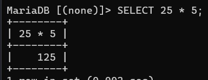

`4. Division(/)`

- Divides the left number by the right number.

```mySQL
    SELECT 200 / 50;
```

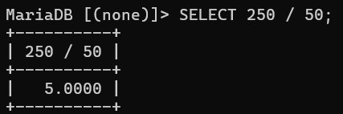

`5. Modulus(%)`

- Returns the remainder of a division operation.

```mySQL
    SELECT 40 % 4;
```

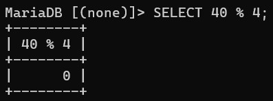

### Comparison operators

Comparison operators are used in the WHERE clause to compare values and filter database records. They return TRUE, FALSE, or NULL.
`1. Equal to (=)`

- Checks if two values are equal.

```mySQL
    SELECT * FROM products
    WHERE price = 25;
```

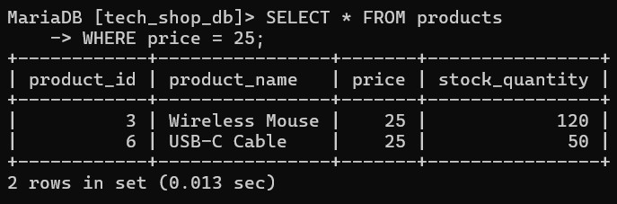

`2. Greater than (>)`

- Checks if the left value is strictly greater than the right value.

```mySQL
    SELECT * FROM products
    WHERE price > 300;
```

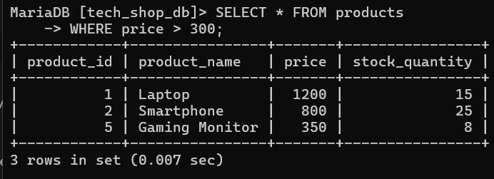

`3. Less than (<)`

- Checks if the left value is strictly less than the right value.

```mySQL
    SELECT * FROM products
    WHERE price < 100;
```

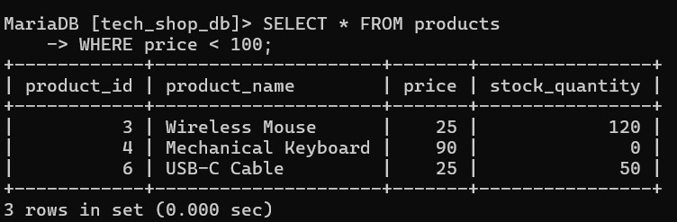

`4. Greater than or equal to (>=)`

- Checks if the left value is greater than or equal to the right value.

```mySQL
    SELECT * FROM products
    WHERE stock_quantity >= 25;
```

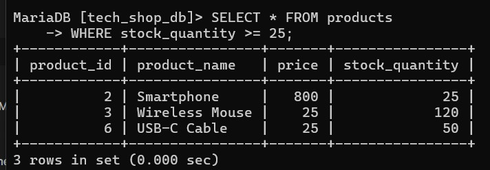

`5. Less than or equal to (<=)`

- Checks if the left value is less than or equal to the right value.

```mySQL
    SELECT * FROM products
    WHERE stock_quantity <= 15;
```

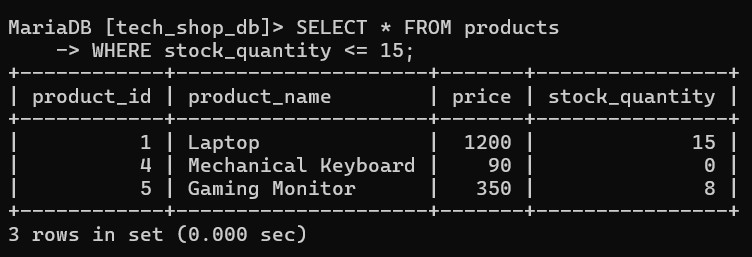

`6. Not equal to (<>)`

- Checks if two values are not equal. You can also use !=.

```mySQL
    SELECT * FROM products
    WHERE stock_quantity <> 0;
```

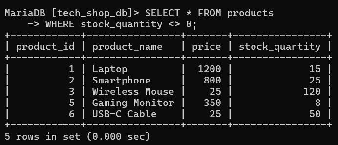

### Compound operators

Compound operators perform an operation and assign the result back to a column or variable in a single step.
`1. Add equals (+=)`

- Increases the current value by a specified number.

```mySQL
UPDATE products
SET price = price + 10;
```

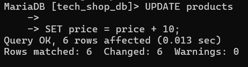

`2. Subtract equals (-=)`

- Decreases the current value by a specified number.

```mySQL
UPDATE products
SET stock_quantity = stock_quantity - 5
WHERE product_name = 'Laptop';
```

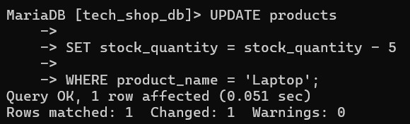

`3. Multiply equals (\*=)`

- Multiplies the current value by a specified number.

```mySQL
UPDATE products
SET price = price * 2;
```

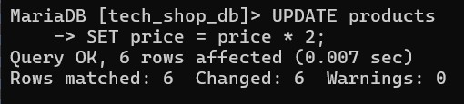

`4. Divide equals (/=)`

- Divides the current value by a specified number.

```mySQL
UPDATE products
SET price = price / 2;
```

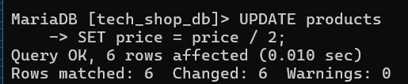

`5. Modulo equals (%=)`

- Calculates the remainder and updates the value.

```mySQL
UPDATE products
SET stock_quantity = stock_quantity % 10;
```

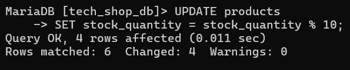

`6. Bitwise AND equals (&=)`

- Performs a bitwise AND operation and updates the column with the result.

```sql
    UPDATE products
    SET status_code = status_code & 4;
```

---

`7. Bitwise exclusive equals (^-=)`

- Performs a bitwise XOR operation and updates the column with the result.

```sql
    UPDATE products
    SET status_code = status_code ^ 2;
```

---

`8. Bitwise OR equals (|\*=)`

- Performs a bitwise OR operation and updates the column with the result.

```sql
    UPDATE products
    SET status_code = status_code | 1;
```

---

> ⚠️ **Important Note on Compound Operators:**
> Unlike programming languages like C++ or JavaScript, Standard MySQL does NOT support compound operators like `+=`, `-=`, `*=`, or `/=`. Instead, explicit assignment expressions like `SET price = price + 10` must be used during `UPDATE` operations.

### Bitwise operators

1. Bitwise AND (&)
2. Bitwise OR (|)
3. Bitwise exclusive 0R (^)

### Logical operators

1. AND

```SQL
    SELECT * FROM products
    WHERE price > 100 AND stock_quantity > 10;
```

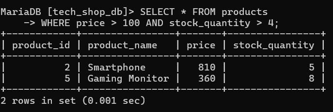

2. OR

```SQL
    SELECT * FROM products
    WHERE price > 1000 OR stock_quantity = 0;
```

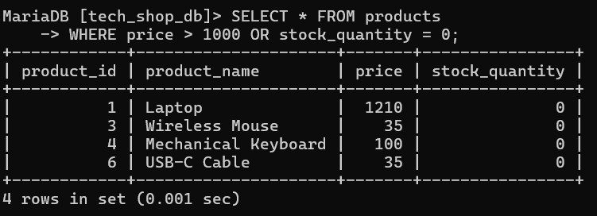

3. NOT

```SQL
    SELECT * FROM products
    WHERE NOT price = 25;
```

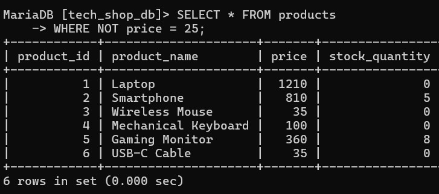

4. BETWEEN

```SQL
    SELECT * FROM products
    WHERE price BETWEEN 50 AND 500;
```

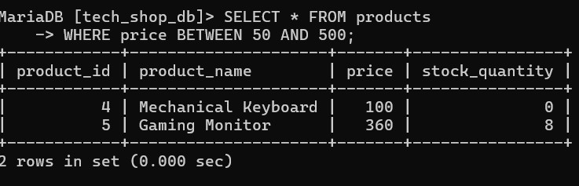

5. IN

```SQL
    SELECT * FROM products
    WHERE product_name IN ('Laptop', 'Smartphone', 'Wireless Mouse');
```

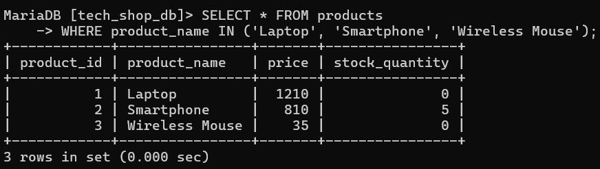

6. LIKE

```SQL
    SELECT * FROM products
    WHERE product_name LIKE 'Gaming%';
```

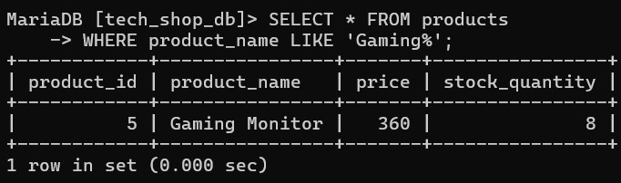

7. EXISTS

```SQL
    SELECT * FROM products
    WHERE EXISTS (SELECT product_id FROM products WHERE price > 1000);
```

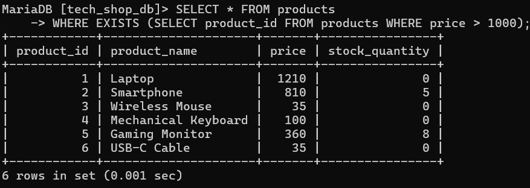

8. ANY / SOME

```SQL
    SELECT * FROM products
    WHERE price > ANY (SELECT price FROM products WHERE price IN (25, 90));
```

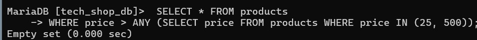

9 ALL

```SQL
    SELECT * FROM products
    WHERE price > ALL (SELECT price FROM products WHERE price IN (25, 90));
```

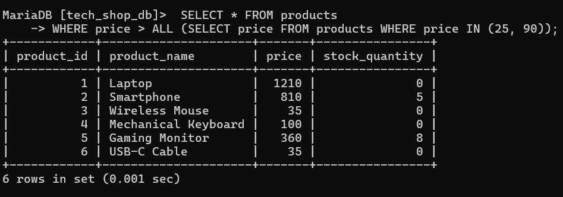

---

