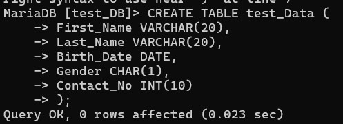
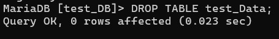
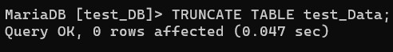
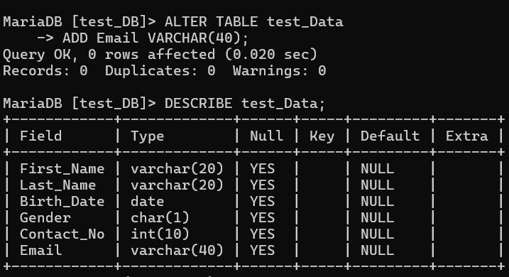
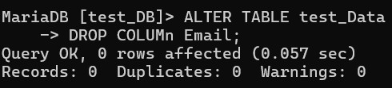
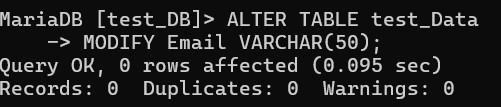
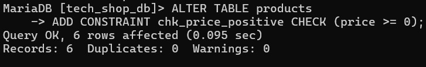
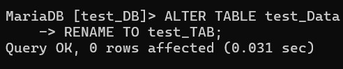
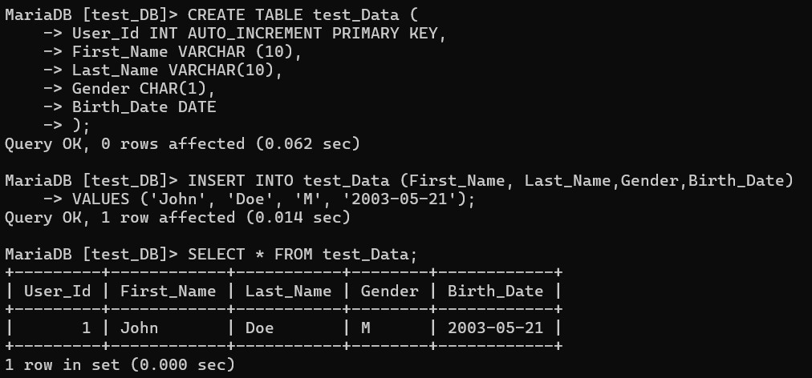

<div align="center">

# 🚀 My SQL Learning Portfolio

### Building My Full Stack Development Journey, One Lesson at a Time.


<br><br>

<a href="https://github.com/mr-nexora">

</a>

<a href="https://www.linkedin.com/in/mrnexora/">

</a>

<a href="https://mr-nexora.github.io/mr-nexora-personal-portfolio/">

</a>

</div>

---

# 👋 Welcome

Welcome to my **MySQL Learning Repository**.

This repository documents my complete learning journey in MySQL as part of my Full Stack Development roadmap. Every lesson includes well-organized SQL queries, explanations, practice exercises, database designs, and real-world examples to strengthen my database management and query writing skills.

---

# 📂 Repository Overview

| 📌 Information | Details |
|:---------------|:--------|
| 👨‍💻 Author | **T.M.S.U. Thennakoon (Sahan Udara)** |
| 🎓 Program | Computer Science Undergraduate |
| 💻 Technology | mySQL |
| 📚 Learning Method | Daily Lessons & Hands-on Practice |
| 🎯 Goal | Become a Professional Full Stack Developer |
| 📅 Repository Started | 2026 |

---

# ✨ What's Inside

- 📖 Structured Lessons
- 💻 Source Code
- 📷 Output Screenshots
- 📝 Markdown Notes
- 🚀 Mini Projects
- 📚 Practice Exercises
- 📈 Continuous Progress Updates

---

# 🌍 Connect With Me

<div align="center">

<a href="https://github.com/mr-nexora">

</a>

<a href="https://www.linkedin.com/in/mrnexora/">

</a>

<a href="https://mr-nexora.github.io/mr-nexora-personal-portfolio/">

</a>

</div>

---

# 📚 Learning Resources

This repository is built through continuous practice using educational resources such as:

- W3Schools
- MDN Web Docs
- freeCodeCamp

---

# ⚖️ Copyright

> **© 2026 T.M.S.U. Thennakoon (Sahan Udara). All Rights Reserved.**
>
> This repository has been created for educational, portfolio, and personal learning purposes.
>
> You are welcome to explore the code and learn from it. However, copying, redistributing, or presenting this work as your own without permission is not allowed.

---
<div align="center">

⭐ If you find this repository useful, consider giving it a Star.

Happy Coding! 🚀

</div>

---
# Managing-Tables
In MySQL, table management involves creating tables to store data, viewing table structures, modifying existing tables, and deleting tables when they are no longer needed.

## MySQL Create Table
The `CREATE TABLE` statement is used to create a new table in a database. You must specify the column names, their data types, and any optional constraints (e.g., `NOT NULL`, `PRIMARY KEY`).
```sql
     CREATE TABLE table_name (
    column1 datatype constraint,
    column2 datatype constraint,
    column3 datatype constraint,
    ....
    );
```



---
## Show Table
To view the structure, column names, data types, and constraints of an existing table, you can use the `DESCRIBE` command (or `DESC`).
```sql
    DESCRIBE table_name;
```


---
## MySQL Drop Table
The `DROP TABLE` statement completely deletes an existing table and all of its stored data permanently from the database.
```sql
    DROP TABLE table_name;
```



### MySQL TRUNCATE TABLE
The `TRUNCATE TABLE` statement deletes all rows/records from a table while keeping the table structure intact for future use.
```sql
    TRUNCATE TABLE table_name;
```



---
## MySQL Alter Table
The `ALTER TABLE` statement is used to add, delete, modify, or rename columns and constraints in an existing table structure without dropping it.
### Add column - Adds a new column to a table
Appends a new column to the end of an existing table structure.
```sql
    ALTER TABLE table_name
    ADD column_name datatype;
```



### Drop column - Deletes a column in a table
Permanently removes an unwanted column and its associated data from the table.
```sql
    ALTER TABLE table_name
    DROP COLUMN column_name;
```



### Rename column - Renames a column
Changes the name of an existing column without affecting its underlying data type.
```sql
    ALTER TABLE table_name
    RENAME COLUMN old_name to new_name;
```

### Modify column - Changes the data type, size, or constraints of a column
Modifies the data type definition, length, or constraints applied to a specific column.
```sql
    ALTER TABLE table_name
    MODIFY column_name new_datatype constraint;
```



### Add constraint - Adds a new constraint
Applies a new rule (such as PRIMARY KEY, FOREIGN KEY, UNIQUE, or CHECK) to an existing table.

```sql
    ALTER TABLE table_name
    ADD CONSTRAINT constraint_name constraint_definition;
```



### Rename table - Renames a table
Changes the name of an existing table to a new name.
```sql
    ALTER TABLE table_name
    RENAME TO new_table_name;
```



---

## MySQL Auto Increment
`AUTO_INCREMENT` allows a unique number to be generated automatically whenever a new record is inserted into a table. This is commonly used for Primary Key fields.
```sql
    CREATE TABLE test_Data (
        User_Id INT AUTO_INCREMENT PRIMARY KEY,
        First_Name VARCHAR (10),
        Last_Name VARCHAR(10),
        Gender CHAR(1),
        Birth_Date DATE
        );
```

```sql
    INSERT INTO test_Data (First_Name, Last_Name,Gender,Birth_Date)
        VALUES ('John', 'Doe', 'M', '2003-05-21');
```



---