<div align="center">

# 🚀 My SQL Learning Portfolio

### Building My Full Stack Development Journey, One Lesson at a Time.


<br><br>

<a href="https://github.com/mr-nexora">

</a>

<a href="https://www.linkedin.com/in/mrnexora/">

</a>

<a href="https://mr-nexora.github.io/mr-nexora-personal-portfolio/">

</a>

</div>

---

# 👋 Welcome

Welcome to my **MySQL Learning Repository**.

This repository documents my complete learning journey in MySQL as part of my Full Stack Development roadmap. Every lesson includes well-organized SQL queries, explanations, practice exercises, database designs, and real-world examples to strengthen my database management and query writing skills.

---

# 📂 Repository Overview

| 📌 Information | Details |
|:---------------|:--------|
| 👨‍💻 Author | **T.M.S.U. Thennakoon (Sahan Udara)** |
| 🎓 Program | Computer Science Undergraduate |
| 💻 Technology | mySQL |
| 📚 Learning Method | Daily Lessons & Hands-on Practice |
| 🎯 Goal | Become a Professional Full Stack Developer |
| 📅 Repository Started | 2026 |

---

# ✨ What's Inside

- 📖 Structured Lessons
- 💻 Source Code
- 📷 Output Screenshots
- 📝 Markdown Notes
- 🚀 Mini Projects
- 📚 Practice Exercises
- 📈 Continuous Progress Updates

---

# 🌍 Connect With Me

<div align="center">

<a href="https://github.com/mr-nexora">

</a>

<a href="https://www.linkedin.com/in/mrnexora/">

</a>

<a href="https://mr-nexora.github.io/mr-nexora-personal-portfolio/">

</a>

</div>

---

# 📚 Learning Resources

This repository is built through continuous practice using educational resources such as:

- W3Schools
- MDN Web Docs
- freeCodeCamp

---

# ⚖️ Copyright

> **© 2026 T.M.S.U. Thennakoon (Sahan Udara). All Rights Reserved.**
>
> This repository has been created for educational, portfolio, and personal learning purposes.
>
> You are welcome to explore the code and learn from it. However, copying, redistributing, or presenting this work as your own without permission is not allowed.

---
<div align="center">

⭐ If you find this repository useful, consider giving it a Star.

Happy Coding! 🚀

</div>

---
# MySQL Constraints

SQL constraints are rules enforced on data columns in a table. They are used to limit the type of data that can go into a table, ensuring accuracy and reliability of the database records.

---

## Not Null

The `NOT NULL` constraint enforces a column to NOT accept `NULL` values. This ensures that a field always contains a value, meaning you cannot insert or update a record without providing data for this field.

### Add NOT NULL Constraint

#### NOT NULL on CREATE TABLE

Defines mandatory columns during table creation.

```sql
    CREATE TABLE Persons (
        ID int NOT NULL,
        LastName varchar(255) NOT NULL,
        FirstName varchar(255) NOT NULL,
        Age int
    );
```

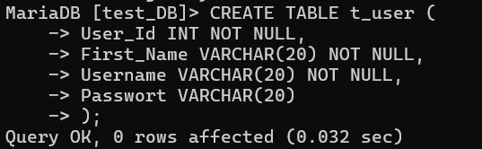

#### NOT NULL on ALTER TABLE

Applies a `NOT NULL` constraint to an existing column using `MODIFY`.

```sql
    ALTER TABLE Persons
    MODIFY Age int NOT NULL;
```

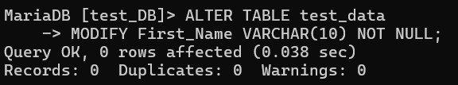

### Remove a NOT NULL Constraint

Removes the mandatory requirement, allowing the column to accept `NULL` values again.

```sql
    ALTER TABLE Persons
    MODIFY Age int NULL;
```

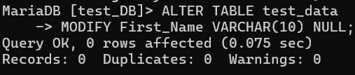

## Unique

The `UNIQUE` constraint ensures that all values in a column are distinct and different from each other. Unlike a Primary Key, a table can have multiple `UNIQUE` constraints.

### UNIQUE Constraint on CREATE TABLE

Enforces unique values on a single column when creating a table.

```sql
    CREATE TABLE Persons (
        ID int NOT NULL,
        LastName varchar(255) NOT NULL,
        FirstName varchar(255),
        Age int,
        UNIQUE (ID)
    );
```

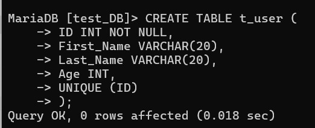

### Naming a Unique Constraint

Assigns a custom constraint name and allows enforcing uniqueness across multiple columns combined.

```sql
    CREATE TABLE Persons (
        ID int NOT NULL,
        LastName varchar(255) NOT NULL,
        FirstName varchar(255),
        Age int,
        CONSTRAINT UC_Person UNIQUE (ID,LastName)
    );
```

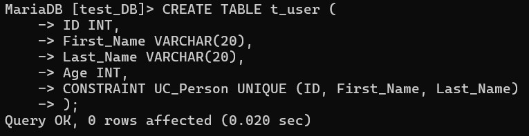

### UNIQUE Constraint on ALTER TABLE

Adds a `UNIQUE` constraint to an existing table.

```sql
    ALTER TABLE Persons
    ADD UNIQUE (ID);
```

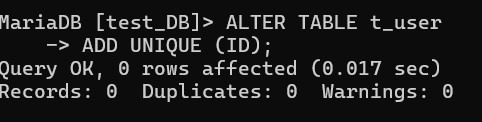

### Naming a Unique Constraint

Adds a named `UNIQUE` constraint across one or more columns on an existing table.

```sql
    ALTER TABLE Persons
    ADD CONSTRAINT UC_Person UNIQUE (ID,LastName);
```

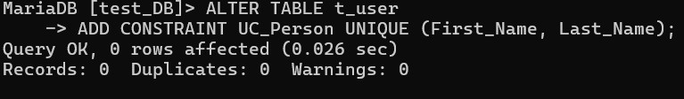

### Drop a UNIQUE Constraint

In MySQL, a `UNIQUE` constraint creates an index under the hood. To drop it, use `DROP INDEX`.

```sql
    ALTER TABLE Persons
    DROP INDEX UC_Person;
```

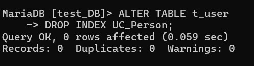

---

## Primary Key

The `PRIMARY KEY` constraint uniquely identifies each record in a table. Primary keys must contain `UNIQUE` values and cannot contain `NULL` values. A table can have only one primary key.

### PRIMARY KEY on CREATE TABLE

Sets a single column as the primary key.

```sql
    CREATE TABLE Persons (
        ID int PRIMARY KEY,
        LastName varchar(255) NOT NULL,
        FirstName varchar(255),
        Age int
    );
```

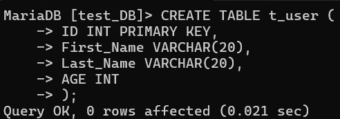

#### PRIMARY KEY on Multiple Columns

A composite primary key uses two or more columns to create a unique identifier for each row.

```sql
    CREATE TABLE Persons (
        ID int,
        LastName varchar(255),
        FirstName varchar(255),
        Age int,
        PRIMARY KEY (ID, LastName)
    );
```

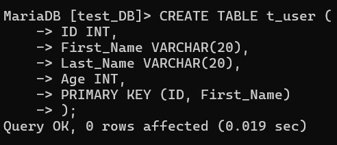

```sql
    CREATE TABLE Persons (
        ID int,
        LastName varchar(255),
        FirstName varchar(255),
        Age int,
        CONSTRAINT PK_Person PRIMARY KEY (ID, LastName)
    );
```

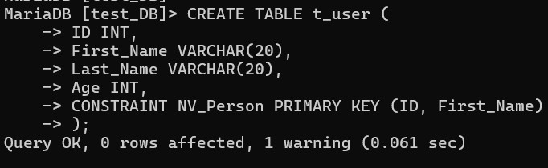

### PRIMARY KEY on ALTER TABLE

Adds a Primary Key to an existing table column.

```sql
    ALTER TABLE Persons
    ADD PRIMARY KEY (ID);
```

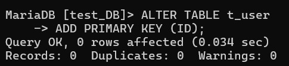

#### PRIMARY KEY on Multiple Columns

Adds a composite Primary Key to an existing table with a constraint name.

```sql
    ALTER TABLE Persons
    ADD CONSTRAINT PK_Person PRIMARY KEY (ID, LastName);
```

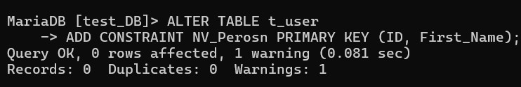

### Drop a PRIMARY KEY Constraint

Removes the primary key constraint from a table.

```sql
    ALTER TABLE Persons
    DROP PRIMARY KEY;
```

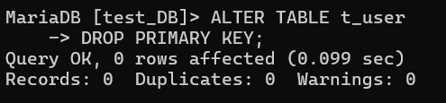

---

## Foreign Key

A `FOREIGN KEY` is used to prevent actions that would destroy links between tables. It is a field (or collection of fields) in one table that refers to the `PRIMARY KEY` in another table.

### FOREIGN KEY on CREATE TABLE

Links `Orders.PersonID` to `Persons.PersonID` upon table creation.

```sql
    CREATE TABLE Orders (
        OrderID int PRIMARY KEY,
        OrderNumber int NOT NULL,
        PersonID int,
        CONSTRAINT fk_Person
        FOREIGN KEY (PersonID)
        REFERENCES Persons(PersonID)
    );
```

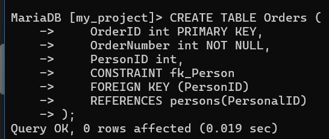

### FOREIGN KEY on ALTER TABLE

Adds a foreign key constraint to an existing table.

```sql
    ALTER TABLE Orders
    ADD CONSTRAINT fk_Person
    FOREIGN KEY (PersonID)
    REFERENCES Persons(PersonID);
```

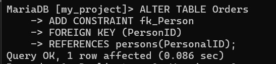

### Drop a FOREIGN KEY Constraint

Removes a foreign key constraint by specifying its name.

```sql
    ALTER TABLE Orders
    DROP FOREIGN KEY fk_Person;
```

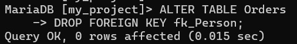

---

## Check

The `CHECK` constraint is used to limit the value range that can be placed in a column. It evaluates inserted/updated data as TRUE or FALSE.

### CHECK Constraint on ALTER TABLE

Enforces a condition on an existing table column.

```sql
    ALTER TABLE persons
    ADD CONSTRAINT chk_PersonAge CHECK (Age >= 18);
```

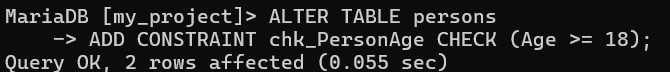
`Check`
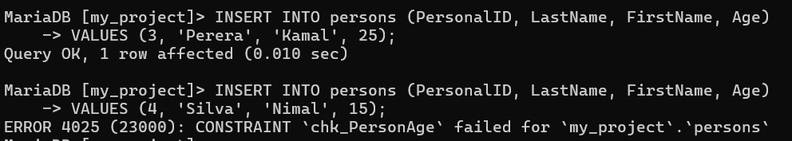

### Naming a CHECK Constraint

Combines multiple conditions across columns into a single named constraint.

```sql
    ALTER TABLE persons
    ADD CONSTRAINT chk_PersonDetails CHECK (Age >= 18 AND LastName != '');
```


### CHECK Constraint on CREATE TABLE

Enforces range rules during table creation.

```sql
    CREATE TABLE Employees (
        EmpID int PRIMARY KEY,
        Name varchar(255) NOT NULL,
        Age int,
        Salary decimal(10, 2),
        CONSTRAINT chk_EmployeeData CHECK (Age >= 18 AND Salary >= 20000)
    );
```

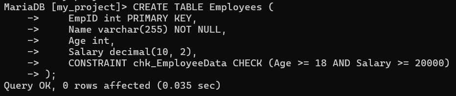

### Drop a CHECK Constraint

Deletes a named `CHECK` constraint (Use `DROP CONSTRAINT` for universal compatibility across MariaDB and MySQL).

```sql
    ALTER TABLE Employees
    DROP CONSTRAINT chk_EmployeeData;
```

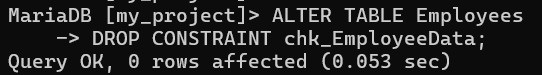

---

## Default

The `DEFAULT` constraint is used to automatically insert a default value into a column if no other value is specified during an `INSERT` operation.

### DEFAULT Constraint on CREATE TABLE

Assigns a default system function value (e.g., `CURRENT_TIMESTAMP()`) to a column.

```sql
    CREATE TABLE Payments (
        PaymentID int PRIMARY KEY,
        Amount decimal(10,2) NOT NULL,
        PaymentDate datetime DEFAULT CURRENT_TIMESTAMP()
    );
```

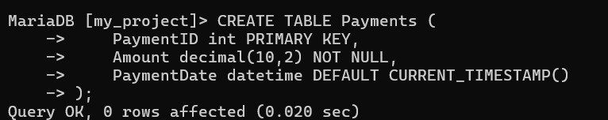

- `Test`

```sql
    INSERT INTO Payments (PaymentID, Amount)
    VALUES (1, 5000.00);

    SELECT * FROM Payments;
```

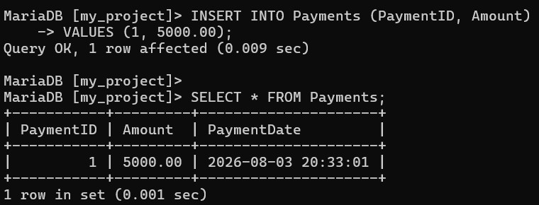

### DEFAULT Constraint on ALTER TABLE

Sets a default literal string value on an existing column.

```sql
ALTER TABLE persons
ALTER City SET DEFAULT 'Colombo';
```

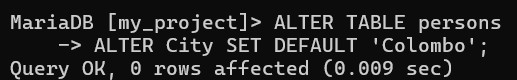

```sql
    ALTER TABLE persons
    ALTER City DROP DEFAULT;
```

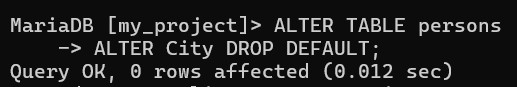

---
